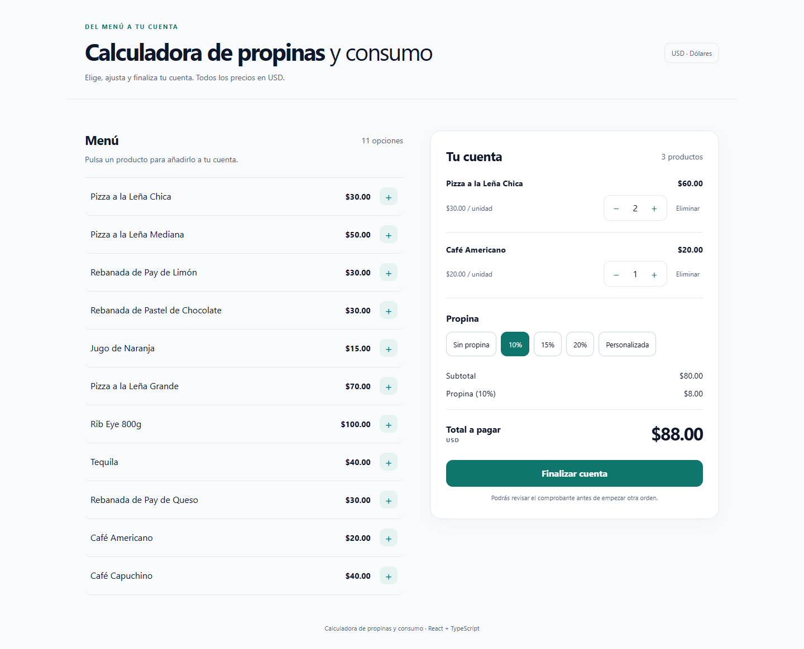
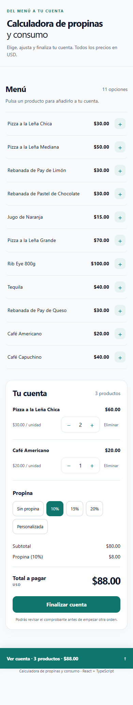
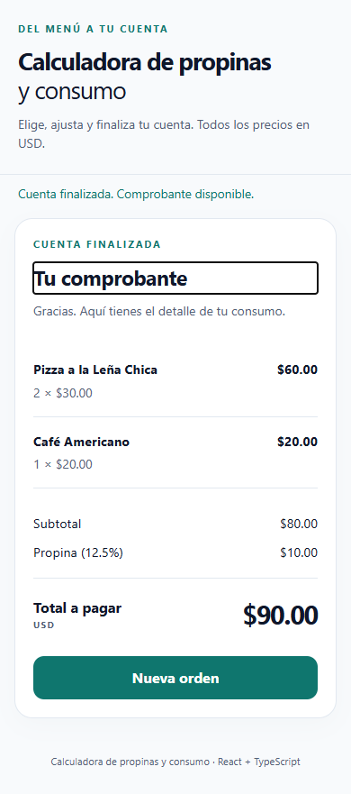

# Calculadora de propinas y consumo

Selecciona productos de un menú, ajusta cantidades y calcula el total con una propina opcional. Al finalizar, obtienes un comprobante con el detalle de la cuenta. Todos los importes están expresados en **USD**.

**[Ver demo pública](https://calculadorapropinaejercicio.netlify.app/)** · [Repositorio](https://github.com/Alexxeyrp/calculadora_propina)

> La demo corresponde a la versión publicada anteriormente. Las mejoras de esta entrega se han realizado y comprobado localmente; no se ha desplegado esta versión.

## Funcionalidades

- Añadir productos sin duplicar líneas; aumentar, reducir o eliminar todas las unidades de un producto.
- Propinas de 0%, 10%, 15%, 20% y personalizada entre 0 y 100 con hasta dos decimales. Admite coma o punto decimal.
- Subtotal y total en céntimos; la propina se redondea una sola vez.
- Comprobante en memoria con productos, cantidades, precios, porcentaje aplicado y totales. Permanece hasta seleccionar «Nueva orden»; no se conserva al recargar.
- Recuperación del pedido en curso mediante un borrador versionado en localStorage.
- Barra inferior móvil con suma de unidades y acceso directo a la cuenta; resumen fijo con desplazamiento interno en escritorio.
- Radios nativos, errores asociados al campo, anuncios breves, foco visible y gestión del foco al eliminar líneas, finalizar y empezar otra orden.
- Interfaz en español, diseño adaptable y respeto de la preferencia de movimiento reducido.

## Capturas de esta versión local

Las capturas se generan con el navegador real mediante el script de comprobación descrito abajo.







## Origen y mejoras propias

El proyecto nació como un ejercicio de un curso de React para practicar componentes, props, estado y hooks. Se conserva esa base con React, TypeScript, Vite, Tailwind CSS y React Compiler.

Esta ampliación incorpora el flujo de finalización y comprobante, edición de cantidades, validación de propinas, persistencia defensiva, cálculos en céntimos, accesibilidad, diseño adaptable, pruebas y CI. También elimina el producto duplicado del catálogo y unifica el formato monetario.

## Estructura y decisiones

- [App](src/App.tsx): composición, regiones y foco del comprobante y nueva orden.
- [Componentes](src/components/): menú, líneas de consumo, opciones de propina y totales.
- [useOrder](src/hooks/useOrder.ts): estado de la cuenta, operaciones y copia independiente del comprobante.
- [Helpers](src/helpers/index.ts): validación y cálculos puros. Los precios del catálogo se convierten a céntimos al calcular; el formato monetario siempre recibe céntimos.
- [Persistencia](src/helpers/storage.ts): inicialización perezosa antes de la primera escritura. Solo almacena identificadores y cantidades, junto con la propina válida; recupera nombres y precios del catálogo actual.
- [Catálogo](src/data/db.ts) y [tipos](src/types/index.ts): datos y contratos compartidos.
- [CI](.github/workflows/ci.yml): instalación reproducible, lint, pruebas y compilación con comprobación de tipos.

El borrador usa la clave propia `calculadora-propina:draft:v1`. Rechaza versiones desconocidas, identificadores inexistentes, duplicados y cantidades inválidas. Las cantidades se limitan a 9.999 unidades por línea. Los errores de almacenamiento no interrumpen el uso de la calculadora y nunca se borran claves de otras aplicaciones.

Si una propina personalizada es inválida, se muestra el error, se aplica provisionalmente 0% y no se permite finalizar. En el borrador solo se conserva una propina válida (0% en ese caso). Al finalizar o vaciar la cuenta se elimina el borrador. «Nueva orden» restablece todos los controles.

No hay backend, autenticación ni historial permanente de cuentas.

## Desarrollo

Utiliza **Node 22.13 o posterior de la rama 22** (archivo [.nvmrc](.nvmrc)); también son compatibles Node 24 y 26. La comprobación local se realizó con Node 22.16.0.

```bash
npm ci
npm run dev
npm run lint
npm test
npm run test:watch
npm run build
npm run preview
npm run format
```

`npm run build` ejecuta `tsc -b` antes de generar la carpeta `dist`.

## Pruebas

Vitest y React Testing Library cubren adición repetida, cambios de cantidad, eliminación, cálculos y redondeo, propinas válidas e inválidas, comprobante, nueva orden, foco, restauración, datos corruptos y almacenamiento bloqueado.

Para repetir la comprobación de navegador y regenerar capturas, instala Chromium y ejecuta el servidor en otra terminal:

```bash
npx playwright install chromium
npm run dev -- --port 5180
npm run test:browser
```

El script utiliza por defecto `http://127.0.0.1:5180`. Puedes cambiarlo con la variable de entorno `APP_URL`. Comprueba anchos de 320, 390, 768, 1024 y 1440 px, ausencia de desbordamiento horizontal, restauración al recargar, acceso móvil a la cuenta, controles sin quedar ocultos bajo la barra, propina, comprobante y navegación con teclado. Guarda capturas reales en [docs/screenshots](docs/screenshots/).

## Netlify

- Comando de compilación: `npm run build`.
- Carpeta de publicación: `dist`.
- Versión de Node: 22.13 o posterior de la rama 22.

El despliegue se realiza desde Netlify conectando el repositorio o publicando la compilación. Esta entrega no hace push ni despliegue.

## Comprobaciones de esta entrega

- Lint, 27 pruebas automatizadas y compilación con comprobación de tipos: correctos.
- Chromium: flujo de recarga, propinas, comprobante y nueva orden; teclado y foco; anchos de 320, 390, 768, 1024 y 1440 px, sin desbordamiento horizontal.
- Capturas reales revisadas de escritorio, móvil y comprobante.
- Se aplicaron actualizaciones compatibles de dependencias. npm audit sigue indicando 10 avisos moderados en dependencias de desarrollo de ESLint/TypeScript ESLint asociados a minimatch; la corrección automática restante propone un cambio mayor y queda pendiente de una revisión específica.
- La comprobación de accesibilidad cubre semántica, teclado, foco y presentación visual; no se ha realizado una auditoría con lectores de pantalla ni una prueba en dispositivos físicos.
